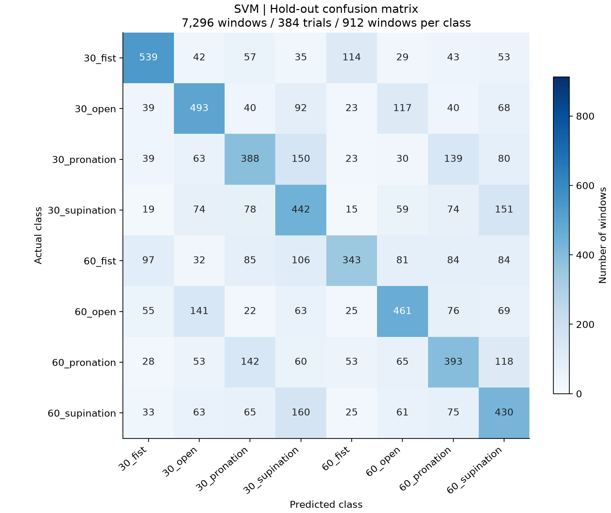
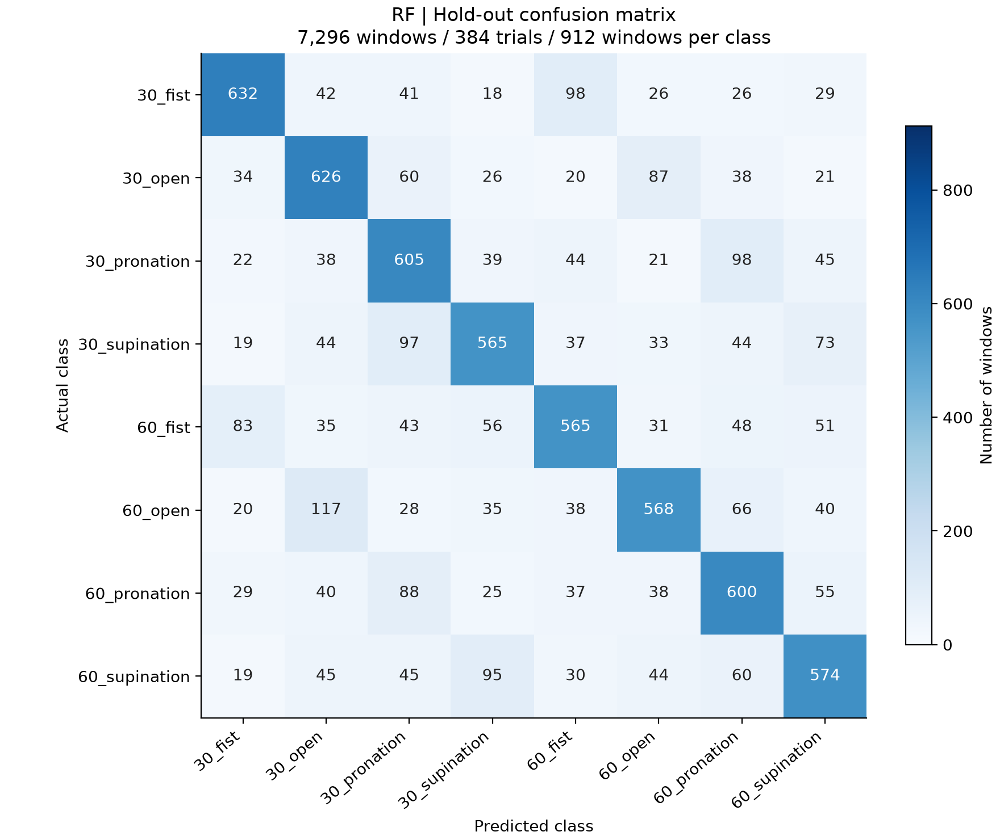

# AI 모델 재현 및 성능 비교

## 1. 코드 설명

### 사용 데이터 및 전처리 방법

본 과제는 표면 근전도(sEMG) 신호에서 손동작과 팔꿈치 각도를 함께 분류하는 실험이다. 손동작만 맞히는 4클래스 분류가 아니라, 손동작 4종과 각도 2종을 조합한 8클래스 분류로 구성했다. 예를 들어 `30_fist`와 `60_fist`는 손동작은 같아도 서로 다른 클래스로 처리한다.

| 항목 | 내용 |
| --- | --- |
| 피험자 | 8명(a~h) |
| 손동작 | 주먹 쥐기(fist), 손 펴기(open), 회내(pronation), 회외(supination) |
| 팔꿈치 각도 | 30°, 60° |
| 원본 데이터 | CSV 64개 · 파일당 30회 · 총 1,920회 시행 |
| 샘플링 주파수 | 1,000 Hz · 시간 간격 1 ms |
| 입력 채널 | 5개 · ECR, ED, FDS, Biceps, Triceps 순서 |
| 시행 길이 | 약 5초 · 실제 4,999~5,001샘플 |
| 모델 입력 | 200 ms 창 하나에서 추출한 25차원 특징 벡터 |
| 모델 출력 | 손동작·각도 조합 클래스 1개 |

클래스 이름의 숫자는 팔꿈치 각도, 뒤의 영문은 손동작을 의미한다. 원본 파일명의 `pro`는 `pronation`, `extor`는 코드에서 `supination`으로 통일했다.

| 손동작 | 30° 클래스 | 60° 클래스 |
| --- | --- | --- |
| 주먹 쥐기 | `30_fist` | `60_fist` |
| 손 펴기 | `30_open` | `60_open` |
| 회내 | `30_pronation` | `60_pronation` |
| 회외 | `30_supination` | `60_supination` |

#### 전처리 순서

`CSV 읽기 → 시행 분리 → 필터링 → 분석 구간 선택 → 윈도우 분할 → 특징 추출 → 학습 데이터 기준 표준화` 순서로 처리했다.

1. **시행 분리:** CSV의 `mark`가 1인 위치를 시행 시작점으로 사용했다. 파일 하나에 반복 동작 30회가 들어 있으며, 다음 시작점까지를 한 시행으로 구분했다. 시간 간격, 채널 수, 이벤트 값, 결측값·무한값을 확인한 뒤 특징을 계산했다.
2. **필터링:** 제공된 `bandpass 1~5` 채널에 강의 실습 조건의 필터를 추가 적용했다. 60 Hz 노치 필터(Q=30)로 해당 주파수 성분을 줄이고, 4차 Butterworth 20~450 Hz 대역통과 필터를 적용했다. 각 시행의 시간축에 `filtfilt`를 적용해 필터링에 따른 위상 지연을 줄였다.
3. **분석 구간 선택:** 시행 시작점 이후 1.5초부터 3.5초 직전까지, 총 2초(2,000샘플)를 사용했다. 모든 시행에서 같은 구간을 사용하도록 정한 실습 조건이며, 신호에서 동작 시작·종료를 자동 검출한 결과는 아니다.
4. **윈도우 분할:** 200 ms(200샘플) 길이의 창을 100 ms(100샘플) 간격으로 이동했다. 인접 창은 50% 겹치며, 한 시행의 분석 구간에서 19개 창이 만들어진다.
5. **특징 추출:** 각 창의 5개 채널에서 아래 5개 특징을 각각 계산해 `5개 특징 × 5개 채널 = 25차원` 벡터를 만들었다. 전체 1,920회 시행에서는 총 36,480개 창이 생성된다.
6. **표준화:** `StandardScaler`로 특징별 평균을 빼고 표준편차로 나눴다. 진폭 특징, 변화량, 횟수 특징은 값의 크기와 단위가 다르기 때문에 같은 기준의 입력을 만들었다. 평균과 표준편차는 매번 해당 학습 데이터에서만 구하고, 검증·테스트 데이터에는 그 값을 그대로 적용했다.

| 특징 | 계산 방법 | 나타내는 정보 |
| --- | --- | --- |
| RMS | 신호 제곱의 평균에 제곱근 적용 | 창 안의 신호 크기 |
| MAV | 신호 절댓값의 평균 | 평균적인 신호 진폭 |
| WL | 연속 샘플 차이의 절댓값을 합산 | 창 안에서 신호가 변화한 전체 크기 |
| ZC | 부호가 바뀌면서 샘플 차이가 0.01 이상인 횟수 | 작은 변동을 제외한 영점 교차 횟수 |
| SSC | 연속된 기울기의 부호가 바뀐 횟수 · 별도 임계값 없음 | 파형의 상승·하강 방향 변화 |

특징 열은 `RMS_Ch1~Ch5`, `MAV_Ch1~Ch5`, `WL_Ch1~Ch5`, `ZC_Ch1~Ch5`, `SSC_Ch1~Ch5` 순서다. ZC의 임계값 0.01은 표준화하기 전 필터링된 신호에 적용했다. 모델에는 원본 파형 전체가 아니라 이 25개 통계량을 입력한다.

### 사용한 AI/ML 모델

서로 다른 분류 방식을 비교하기 위해 SVM, Random Forest, XGBoost를 사용했다. 세 모델 모두 같은 25차원 특징과 같은 데이터 분할을 사용하며, 표준화와 분류기를 하나의 Pipeline으로 묶었다.

| 모델 | 분류 방식 | 주요 설정 |
| --- | --- | --- |
| SVM | RBF 커널을 이용한 비선형 분류 경계 | kernel=rbf, C=1.0, gamma=scale |
| RF(Random Forest) | 여러 결정트리의 예측을 결합 | 트리 100개, 최대 깊이 제한 없음, random_state=42 |
| XGBoost | 앞선 예측의 오차를 줄이도록 트리를 순차 학습 | 트리 400개, 깊이 6, 학습률 0.05, subsample=0.9, colsample_bytree=0.8, random_state=42 |

SVM은 특징 공간에서 클래스를 나누는 경계를 학습하는 비교 모델로 사용했다. RF와 XGBoost는 특징값에 대한 조건을 여러 단계로 조합하는 트리 기반 모델이다. XGBoost는 8개 클래스의 확률을 계산하는 `multi:softprob` 목적함수를 사용했다. 이번 결과는 위 설정에서의 비교이며, 모델마다 최적 설정을 탐색한 결과는 아니다.

### 학습 및 테스트 방법

| 구분 | 시행 수 | 윈도우 수 | 클래스당 구성 |
| --- | --- | --- | --- |
| 학습 | 1,536회(80%) | 29,184개 | 192회 · 3,648개 창 |
| 테스트 | 384회(20%) | 7,296개 | 48회 · 912개 창 |
| 전체 | 1,920회 | 36,480개 | 240회 · 4,560개 창 |

1. **시행 단위 분할:** 클래스 비율을 유지하면서 시행을 학습 80%, 테스트 20%로 나눴다. 같은 시행에서 나온 19개 창은 모두 같은 집합에 배치했다. 창 단위로 무작위 분할하면 서로 50% 겹치는 창이 학습과 테스트에 나뉠 수 있으므로, 시행 ID를 기준으로 묶어 분리했다.
2. **학습셋 내부 교차검증:** 테스트셋을 제외한 학습 시행 1,536회만 사용해 5-fold 교차검증을 수행했다. 각 폴드에서 일부 시행을 검증용으로 사용하고 나머지로 학습했으며, 세 모델에 동일한 폴드 구성을 적용했다. 분할 시 난수 시드는 42로 고정했다.
3. **폴드별 표준화:** 교차검증 폴드마다 새로운 Pipeline을 만들고 그 폴드의 학습 데이터에서만 표준화 통계를 계산했다. 이전 실습에서 전체 학습셋으로 표준화해 둔 `Xtr` 대신 `Xtr_raw`를 읽기 때문에, 검증 폴드의 통계가 학습에 섞이지 않는다.
4. **모델 선택:** 다섯 폴드의 macro F1-score 평균이 가장 높은 모델을 선택했다. 테스트셋 점수를 보고 설정을 바꾸거나 모델을 다시 선택하지 않았다.
5. **최종 평가:** 설정을 고정한 각 모델을 전체 학습셋으로 다시 학습한 뒤, 동일한 테스트셋에서 한 번씩 예측했다. Accuracy·macro Precision·macro Recall·macro F1-score와 8×8 혼동행렬을 계산했다.

피험자 자체를 학습·테스트로 나눈 분할은 아니며, 동일한 피험자 집단에서 서로 다른 시행을 나눠 평가했다. 따라서 아래 수치는 이번 시행 분할의 분류 성능이다. 각 창을 한 번의 예측으로 평가했으며, 시행별 19개 예측을 다수결로 합친 정확도는 사용하지 않았다.

### 실행 방법

Python 3.12 이상과 pyproject.toml에 명시한 패키지가 설치된 가상환경을 활성화한 뒤, 프로젝트 폴더에서 실행한다.

```bash
python3 main.py
```

현재 실습 폴더에서는 패키지가 설치된 기존 환경을 사용해 바로 실행할 수 있다.

```bash
../Step2_1주차/.venv/bin/python main.py
```

기본 실행은 포함된 `data/dataset.npz`를 읽는다. 5-fold 교차검증과 모델 선택을 수행한 뒤 세 모델을 최종 학습·평가하고, `results/`의 수치 결과와 `figures/`의 그림을 갱신한다. 실행 중에는 모델별 학습 진행 상황과 평가 점수가 터미널에 표시된다. `main.py` 실행은 README를 수정하지 않는다.

원본 CSV부터 전처리를 다시 수행하려면 CSV 64개를 `data/raw/`에 넣은 뒤 아래 순서로 실행한다. 이미 포함된 특징 데이터로 모델 비교만 실행할 경우에는 앞의 `main.py` 실행만으로 충분하다.

```bash
python3 preprocessing/build_dataset.py
python3 main.py
```

### 코드 설명

| 파일 | 설명 |
| --- | --- |
| `main.py` | 전체 실험의 시작점. 데이터 읽기, 학습·평가, 그림 생성, 결과 검증을 순서대로 실행한다. |
| `data.py` | 특징 데이터의 크기·라벨·시행 ID를 검증한다. 학습 시행을 기준으로 세 모델이 공통으로 사용할 교차검증 폴드를 만든다. |
| `model.py` | SVM·RF·XGBoost의 설정을 정의하고, 각 모델 앞에 StandardScaler를 연결한 Pipeline을 구성한다. |
| `experiment.py` | 5-fold 교차검증, macro F1 기준 모델 선택, 전체 학습셋 재학습, 테스트 예측을 수행한다. 예측값과 혼동행렬, 평가 수치를 저장한다. |
| `evaluation.py` | Accuracy·Precision·Recall·F1-score를 계산한다. 오류를 각도만 틀림·손동작만 틀림·둘 다 틀림으로 나누고, 폴드 결과의 통계 계산을 담당한다. |
| `analysis.py` | 저장된 결과에서 클래스별 재현율과 가장 잘·잘못 분류된 클래스, 가장 빈번한 오분류 쌍을 계산한다. |
| `figures.py` | 실제 예측 결과를 바탕으로 모델별 혼동행렬과 성능 비교 그림을 생성한다. |
| `documentation.py` | 저장된 평가 수치와 혼동행렬을 읽어 README를 수동으로 다시 작성할 때 사용하는 보조 코드다. main.py에서는 호출하지 않는다. |
| `preprocessing/source_data.py` | CSV의 열 구조와 시간·이벤트 정보를 확인하고, 피험자·각도·동작·시행 정보를 정리한다. |
| `preprocessing/signal_features.py` | 노치·대역통과 필터, 분석 구간 선택, 윈도우 분할, 25차원 특징 계산을 구현한다. |
| `preprocessing/build_dataset.py` | 전처리 함수를 실행해 특징 데이터셋을 만들고, 시행 단위 학습·테스트 분할과 전처리 요약을 저장한다. |
| `verify_results.py` | 저장된 예측값에서 지표와 혼동행렬을 다시 계산해 일치 여부를 확인한다. 시행 중복과 표준화의 학습 범위도 점검한다. |

## 2. 모델 성능 비교

세 모델을 동일한 테스트셋에서 평가한 결과다. 값은 0~1 범위로 표시했으며, 예를 들어 Accuracy 0.6490은 약 64.90%를 의미한다.

| Model | Accuracy | Precision | Recall | F1-score |
| --- | --- | --- | --- | --- |
| SVM | 0.4782 | 0.4857 | 0.4782 | 0.4789 |
| RF | 0.6490 | 0.6510 | 0.6490 | 0.6492 |
| XGBoost | 0.6339 | 0.6361 | 0.6339 | 0.6342 |

테스트 7,296개 윈도우를 기준으로 계산했다. Precision·Recall·F1-score는 8개 클래스의 값을 동일한 비중으로 평균한 macro 지표다. Macro 평균은 이번 실습에서 선택한 평가 방식이다.

| 평가 지표 | 계산 및 확인할 내용 |
| --- | --- |
| Accuracy | 전체 테스트 창 중 클래스를 정확히 맞힌 비율 |
| Precision | 특정 클래스로 예측한 창 중 실제로 그 클래스인 비율을 클래스별로 계산한 뒤 평균 |
| Recall | 실제 특정 클래스인 창 중 해당 클래스로 맞힌 비율을 클래스별로 계산한 뒤 평균 |
| F1-score | 각 클래스의 Precision과 Recall의 조화평균을 구한 뒤 클래스별 F1을 평균 |

이번 테스트셋은 8개 클래스가 각각 912개로 같아 Accuracy와 macro Recall이 일치한다. macro F1은 클래스별 F1을 평균한 값이므로, 표의 평균 Precision과 평균 Recall을 다시 조화평균한 값과는 계산 방식이 다르다.

### 성능 분석

**RF가 Accuracy 64.90%, macro F1-score 0.6492로 가장 높은 성능을 보였다.** 테스트 7,296개 중 4,735개를 맞혔다. XGBoost보다 정확도는 1.51%p, macro F1은 0.0150 높았다. SVM과 비교하면 정확도 차이는 17.08%p이며, 정답 예측 수는 1,246개 더 많았다.

**RF:** 서로 다른 트리의 판단을 결합하는 방식이 이번 25차원 특징의 분류에 적합했던 것으로 보인다. 한 가지 특징만으로 나누기 어려운 데이터를 여러 특징의 조건으로 구분할 수 있다. 실제로 RF는 SVM보다 8개 클래스 모두에서 재현율이 높았고, 특정 클래스 하나의 높은 성능에만 의존하지 않았다.

**XGBoost:** SVM보다 전반적인 성능이 높았지만, 이번 고정 설정에서는 RF보다 낮았다. 다만 RF가 모든 클래스에서 XGBoost보다 높은 것은 아니며, `30_pronation`에서는 XGBoost의 정답 수가 더 많았다. 전체 평균 순위와 개별 클래스의 순위가 다를 수 있음을 보여준다.

**SVM:** 이번 비교에서 정확도와 macro F1이 가장 낮았다. RBF 커널을 사용했지만 현재의 특징과 고정한 C·gamma 조건으로는 클래스 간 겹침을 충분히 구분하지 못했을 가능성이 있다. 이 결과만으로 SVM 자체가 항상 부적합하다고 볼 수는 없으며, 입력 특징과 설정에 따라 성능은 달라질 수 있다.

학습셋 내부 5-fold 교차검증의 macro F1 평균은 SVM 0.4611, RF 0.6313, XGBoost 0.6204였다. 교차검증에서 선택된 모델은 RF였고, 고정한 테스트셋에서도 가장 높은 성능을 보였다. 여기서 확인한 것은 이번 분할과 설정에서의 점수 차이이며, 더 복잡한 모델을 쓰는 것만으로 성능이 높아지는 것은 아니었다.

### 5-fold 교차검증 결과

다음은 학습셋 내부의 동일한 다섯 검증 폴드에서 얻은 정확도다. 각 시행의 창 19개는 한 폴드에 함께 배치했다. 테스트셋은 이 교차검증에 사용하지 않았다.

| Fold | SVM Accuracy | RF Accuracy | XGBoost Accuracy |
| --- | --- | --- | --- |
| 1 | 44.84% | 60.73% | 60.58% |
| 2 | 45.09% | 64.17% | 62.63% |
| 3 | 46.44% | 63.21% | 62.08% |
| 4 | 48.93% | 64.05% | 63.35% |
| 5 | 44.75% | 63.50% | 61.53% |

| 모델 | Accuracy 평균 ± 표준편차 (%) | Macro F1 평균 ± 표준편차 |
| --- | --- | --- |
| SVM | 46.01 ± 1.58 | 0.4611 ± 0.0155 |
| RF | 63.13 ± 1.25 | 0.6313 ± 0.0126 |
| XGBoost | 62.03 ± 0.94 | 0.6204 ± 0.0094 |

표준편차는 강의 실습과 같은 `np.std` 기본 설정(ddof=0)으로 계산했다. 정확도의 ± 값은 퍼센트 단위에서 구한 표준편차다. 폴드별 Precision·Recall·F1과 시행 수까지 포함한 원래 값은 `results/cv_folds.csv`에 저장했다.

RF가 평균 정확도와 macro F1에서 가장 높았다. XGBoost는 정확도의 폴드 간 표준편차가 가장 작았지만, 평균 정확도는 RF보다 낮았다. 최종 모델 선택 기준은 macro F1 평균이며, 표준편차는 폴드 간 성능 변동을 확인하는 데 사용했다.

### 대응표본 t-검정

동일한 폴드에서 나온 두 모델의 정확도를 짝지어 대응표본 t-검정을 수행했다. 다섯 쌍의 차이를 사용하므로 자유도는 4이며, 유의수준은 0.05다. 평균 정확도 차이는 표의 앞 모델에서 뒤 모델을 뺀 값으로, 음수이면 뒤 모델의 평균 정확도가 더 높다는 뜻이다.

| 비교 | 평균 정확도 차이 (%p) | t (df=4) | p-value | Holm 보정 p-value |
| --- | --- | --- | --- | --- |
| SVM − RF | -17.12 | -21.9695 | 2.54038e-05 | 5.08077e-05 |
| SVM − XGBoost | -16.02 | -30.0603 | 7.29424e-06 | 2.18827e-05 |
| RF − XGBoost | +1.10 | 3.4717 | 0.0255435 | 0.0255435 |

- **SVM와 RF:** 원 p값과 Holm 보정 p값 모두 0.05 미만으로, 이번 다섯 폴드에서 평균 정확도 차이가 검출되었다. 평균 차이는 -17.12%p다.
- **SVM와 XGBoost:** 원 p값과 Holm 보정 p값 모두 0.05 미만으로, 이번 다섯 폴드에서 평균 정확도 차이가 검출되었다. 평균 차이는 -16.02%p다.
- **RF와 XGBoost:** 원 p값과 Holm 보정 p값 모두 0.05 미만으로, 이번 다섯 폴드에서 평균 정확도 차이가 검출되었다. 평균 차이는 +1.10%p다.

세 쌍 모두 원 p값과 추가로 계산한 Holm 보정 p값이 0.05 미만이었다. 이번 다섯 폴드에서는 모델 간 평균 정확도 차이가 검출됐다는 뜻이다. p값이 0.05 이상인 경우에도 차이를 검출하지 못했다는 뜻이지 두 모델이 동등하다는 증거는 아니다. 또한 교차검증의 학습셋은 서로 겹치므로 이 p값을 독립된 반복 실험의 결과처럼 해석하지 않았다.

강의자료에서는 논문의 세 쌍 모두 유의한 차이가 검출되지 않았다고 소개했지만, 이번 실습에서는 결과가 달랐다. 강의자료의 RF 교차검증 정확도 96.72 ± 0.58%와 이번 63.13 ± 1.25%도 차이가 있다. 이번 전처리·구간 선택·특징 정의·시행 분할이 논문과 완전히 같은 조건인지 검증한 실험은 아니므로, 논문 수치를 그대로 재현했다고 결론내릴 수 없다. 조건별 영향을 분리한 실험도 수행하지 않아 차이의 원인을 한 가지로 단정하지 않았다.

### 계산 비용

| 모델 | 학습 시간 (s) | 단건 추론 시간 (ms/window) |
| --- | --- | --- |
| SVM | 9.181 | 0.6993 |
| RF | 1.722 | 13.1059 |
| XGBoost | 2.231 | 0.2227 |

학습 시간은 전체 학습셋 29,184개 창을 이용한 최종 Pipeline의 fit 한 번을 측정한 값이다. 단건 추론은 StandardScaler와 분류기를 모두 포함한 predict 호출을 10회 준비 실행한 뒤 100회 반복해 평균냈다. `time.perf_counter`를 사용했으며, 측정 환경은 macOS의 Apple Silicon(arm64), CPU 병렬 처리 설정 4개 스레드다.

이번 실행에서는 SVM의 학습이 가장 오래 걸렸고, 단건 추론은 RF가 가장 느리고 XGBoost가 가장 빨랐다. 작은 입력을 반복 호출하는 측정에는 호출과 병렬 처리의 오버헤드도 포함될 수 있다. 강의자료에 소개된 논문의 시간 순위와는 다르며, 이 장비와 호출 방식에서 얻은 시간을 실제 배포 환경의 지연 시간으로 일반화하지 않았다. 최종 선택은 macro F1을 우선해 RF로 유지했고, 단건 응답 시간이 중요하다면 XGBoost도 추가 검토할 수 있다.

## 3. Confusion Matrix 분석

최종 선택 모델 RF의 8클래스 혼동행렬은 강의 제출 파일명인 [`confusion8.png`](figures/confusion8.png)로도 저장했다. 아래 RF 항목에 이 파일을 표시했다.

혼동행렬에서 **행은 실제 클래스, 열은 예측 클래스**다. 대각선은 정답 수이며, 대각선 밖의 값은 특정 실제 클래스를 다른 클래스로 예측한 횟수다. 각 행의 합은 912개이고, 아래에서 가장 잘·잘못 분류된 클래스는 행별 재현율을 기준으로 정했다.

같은 동작의 각도만 틀린 오류와, 각도는 맞지만 동작을 틀린 오류를 구분해 확인했다. 예를 들어 `60_open → 30_open`은 각도만 틀린 경우이고, `30_supination → 30_pronation`은 손동작만 틀린 경우다.

| 모델 | 각도만 틀림 | 손동작만 틀림 | 둘 다 틀림 | 전체 오분류 |
| --- | --- | --- | --- | --- |
| SVM | 1,061 | 1,544 | 1,202 | 3,807 |
| RF | 739 | 1,018 | 804 | 2,561 |
| XGBoost | 769 | 1,036 | 866 | 2,671 |

세 모델 모두 전체 오류를 합치면 손동작만 틀린 경우가 가장 많았다. 반면 한 가지 실제·예측 조합에서 가장 큰 오류는 아래와 같이 동일 동작의 각도를 혼동한 쌍이었다. 대표 오류 한 쌍의 특징과 전체 오류의 분포를 나눠 볼 필요가 있다.

### SVM



- **가장 잘 분류된 클래스:** `30_fist` 539/912개를 맞혔으며, 재현율은 59.10%다. 해당 클래스도 모든 창을 맞힌 것은 아니므로 다른 클래스로 분산된 예측을 함께 확인했다.

- **가장 많이 오분류된 클래스:** `60_fist` 343/912개를 맞혔으며, 재현율은 37.61%다. 클래스마다 569개가 다른 클래스로 예측됐다.

- **주요 오분류 유형:** 실제 클래스 `60_supination`의 창을 다른 클래스 `30_supination`에 속한다고 예측한 경우가 160개로, 실제 해당 클래스의 17.54%다. 반대 방향인 `30_supination → 60_supination`도 151개 발생했다. 손동작이 같아도 각도를 구분하는 과정에서 혼동이 생겼다.

- **오분류가 발생한 이유에 대한 분석:** RBF 커널은 비선형 경계를 만들 수 있지만, 이번 실험에서는 C=1.0과 gamma=scale을 고정해 사용했다. 피험자와 동작에 따라 특징값이 겹치는 구간을 이 설정의 경계로 충분히 나누지 못했을 가능성이 있다. 특히 한 창의 진폭·변화량 통계만 사용하므로 동작이 진행되는 순서나 채널 사이의 시간 관계를 직접 반영하지 못한다.

전체 3,807개 오류 중 각도만 틀린 경우는 1,061개(27.87%), 손동작만 틀린 경우는 1,544개(40.56%), 둘 다 틀린 경우는 1,202개(31.57%)였다. 이 비율의 분모는 전체 테스트 창이 아니라 해당 모델의 오분류 수다.

### RF



- **가장 잘 분류된 클래스:** `30_fist` 632/912개를 맞혔으며, 재현율은 69.30%다. 해당 클래스도 모든 창을 맞힌 것은 아니므로 다른 클래스로 분산된 예측을 함께 확인했다.

- **가장 많이 오분류된 클래스:** `30_supination` 565/912개; `60_fist` 565/912개를 맞혔으며, 재현율은 61.95%다. 클래스마다 347개가 다른 클래스로 예측됐다.

- **주요 오분류 유형:** 실제 클래스 `60_open`의 창을 다른 클래스 `30_open`에 속한다고 예측한 경우가 117개로, 실제 해당 클래스의 12.83%다. 반대 방향인 `30_open → 60_open`도 87개 발생했다. 손동작이 같아도 각도를 구분하는 과정에서 혼동이 생겼다.

- **오분류가 발생한 이유에 대한 분석:** 여러 결정트리가 서로 다른 특징과 학습 표본을 바탕으로 판단한 결과를 결합한다. RMS·MAV처럼 진폭을 나타내는 특징과 WL·ZC·SSC처럼 변화를 나타내는 특징의 조합이 이번 데이터의 구분에 도움이 됐을 가능성이 있다. 다만 각도만 바뀐 동일 동작과 서로 다른 동작의 특징이 비슷한 창에서는 오분류가 남았다.

전체 2,561개 오류 중 각도만 틀린 경우는 739개(28.86%), 손동작만 틀린 경우는 1,018개(39.75%), 둘 다 틀린 경우는 804개(31.39%)였다. 이 비율의 분모는 전체 테스트 창이 아니라 해당 모델의 오분류 수다.

### XGBoost


- **가장 잘 분류된 클래스:** `30_open` 621/912개를 맞혔으며, 재현율은 68.09%다. 해당 클래스도 모든 창을 맞힌 것은 아니므로 다른 클래스로 분산된 예측을 함께 확인했다.

- **가장 많이 오분류된 클래스:** `60_fist` 540/912개를 맞혔으며, 재현율은 59.21%다. 클래스마다 372개가 다른 클래스로 예측됐다.

- **주요 오분류 유형:** 실제 클래스 `60_open`의 창을 다른 클래스 `30_open`에 속한다고 예측한 경우가 118개로, 실제 해당 클래스의 12.94%다. 반대 방향인 `30_open → 60_open`도 93개 발생했다. 손동작이 같아도 각도를 구분하는 과정에서 혼동이 생겼다.

- **오분류가 발생한 이유에 대한 분석:** 이전 단계에서 발생한 오차를 줄이도록 트리를 순차적으로 추가하는 모델이다. 이번에는 깊이 6, 학습률 0.05, 트리 400개의 설정을 고정했다. 이 설정이 모든 클래스의 특징 분포에 똑같이 적합하지는 않았을 가능성이 있다. 트리를 더 많이 사용했다는 사실만으로 다른 모델보다 좋은 성능이 보장되는 것은 아니며, 혼동행렬만으로 과적합 여부를 단정할 수는 없다.

전체 2,671개 오류 중 각도만 틀린 경우는 769개(28.79%), 손동작만 틀린 경우는 1,036개(38.79%), 둘 다 틀린 경우는 866개(32.42%)였다. 이 비율의 분모는 전체 테스트 창이 아니라 해당 모델의 오분류 수다.

### 모델별 클래스 재현율 비교

| 실제 클래스 | SVM | RF | XGBoost |
| --- | --- | --- | --- |
| `30_fist` | 59.10% | 69.30% | 67.32% |
| `30_open` | 54.06% | 68.64% | 68.09% |
| `30_pronation` | 42.54% | 66.34% | 66.89% |
| `30_supination` | 48.46% | 61.95% | 61.40% |
| `60_fist` | 37.61% | 61.95% | 59.21% |
| `60_open` | 50.55% | 62.28% | 61.51% |
| `60_pronation` | 43.09% | 65.79% | 60.75% |
| `60_supination` | 47.15% | 62.94% | 61.95% |

RF는 모든 클래스에서 재현율이 60%를 넘었지만, SVM의 `60_fist`는 40% 미만이었다. 반면 `30_pronation`은 XGBoost가 RF보다 약간 높았다. 이처럼 평균 지표와 클래스별 재현율을 함께 보면 어느 동작·각도 조합에서 개선됐고 어떤 조합에서 오류가 남는지 확인할 수 있다.

## 4. 최종 결과

- **가장 성능이 좋은 모델:** RF. 정확도 64.90%, macro F1-score 0.6492를 기록했다. 학습셋 내부 교차검증에서 먼저 선택된 모델이 테스트에서도 가장 높은 성능을 보였으며, 다른 모델보다 전반적으로 안정적인 클래스별 재현율을 보였다.

- **가장 성능이 낮은 모델:** SVM. 정확도 47.82%, macro F1-score 0.4789였다. 이번 고정 설정에서는 다른 두 모델에 비해 정답 예측 수가 적었고, 일부 클래스에서 재현율이 특히 낮았다. 모델 이름만으로 성능을 예상하기보다 동일한 조건에서 직접 비교해야 한다는 점을 확인했다.

- **주요 오분류 클래스:** 최종 선택 모델 RF에서는 `60_open → 30_open` 오류가 117개로 가장 빈번했다. 동일 손동작의 각도 구분이 어려운 경우가 남았으며, 전체 오류를 합치면 각도는 맞히고 손동작을 틀린 경우도 1,018개로 많았다. 따라서 특정 각도 쌍과 서로 다른 손동작의 혼동을 함께 개선할 필요가 있다.

- **전체적인 실험 결과 및 느낀 점:** 같은 25차원 특징을 입력해도 모델의 분류 방식과 설정에 따라 성능 차이가 나타났다. 특히 겹치는 창을 시행 단위로 묶어 나누고, 표준화 통계를 학습 데이터에서만 계산하는 과정이 평가에 중요하다는 점을 확인했다. 정확도 하나만으로는 오류의 내용을 알기 어려웠지만, 혼동행렬과 클래스별 재현율을 함께 보니 취약한 동작·각도 조합을 구체적으로 파악할 수 있었다. 이후에는 학습셋 내부 교차검증에서 특징 조합, 창 길이, 모델 설정을 비교하고 시간 순서 정보를 반영하는 입력도 검토해 볼 수 있다. 다만 이 개선안의 효과는 아직 실험하지 않았으며, 위 표는 현재 고정한 조건에서 실제로 얻은 결과다.

### 실험의 한계 및 개선 방향

1. **Trial-wise 분할과 새 피험자 일반화:** 학습과 테스트의 시행 ID는 겹치지 않지만 같은 8명의 데이터가 양쪽에 들어 있다. 따라서 현재 결과는 처음 보는 사람에 대한 성능이 아니다. 피험자별 근활성 크기와 측정 특성을 공유했을 가능성이 있으며, 후속 검증에서는 7명으로 학습하고 남은 1명으로 평가하는 LOSO를 8명에 대해 반복할 필요가 있다.
2. **창과 교차검증 폴드의 독립성:** 같은 시행의 인접 창은 50% 겹치므로 7,296개 테스트 창을 서로 완전히 독립된 표본으로 볼 수 없다. 다섯 교차검증 폴드의 학습셋도 서로 겹친다. 시행 단위 분할은 겹친 창이 양쪽 집합에 들어가는 문제를 막지만, 창의 상관관계와 대응표본 t-검정의 독립성 제약까지 없애지는 않는다.
3. **데이터와 출력 범위:** 피험자 8명, 손동작 4종, 팔꿈치 각도 30°·60°의 측정 조건만 평가했다. 새로운 손동작, 다른 각도, 전극 위치나 착용 상태 변화에 대한 실험은 하지 않았다. 출력도 8개 범주 중 하나이며, 연속적인 팔꿈치 각도를 추정하는 회귀 모델은 아니다.
4. **고정한 전처리·특징·설정:** mark 이후 1.5~3.5초, 200 ms 창, 25개 시간영역 특징과 고정한 모델 설정을 사용했다. 시간 순서 정보와 다른 특징 조합, 임계값·창 길이·하이퍼파라미터 변화의 효과는 비교하지 않았다. 이런 조건의 비교는 테스트셋을 반복 참고하지 않고 학습셋 내부 교차검증에서 수행해야 한다.
5. **측정 환경에 따른 계산 비용:** 학습·추론 시간은 한 Mac의 CPU에서 측정한 값이다. 단건 호출과 배치 처리는 오버헤드 비중이 다르며, GPU·다른 CPU·실시간 신호 수집 환경에서 같은 시간이 나온다는 보장은 없다. 실제 적용 단계에서는 목표 장비와 입력 방식으로 지연 시간을 다시 측정해야 한다.
